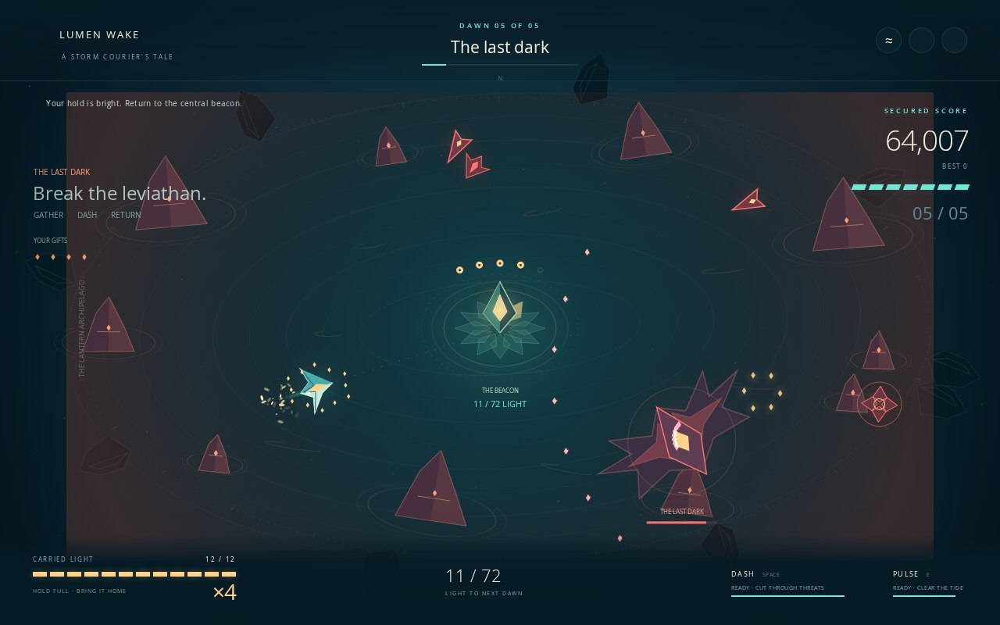
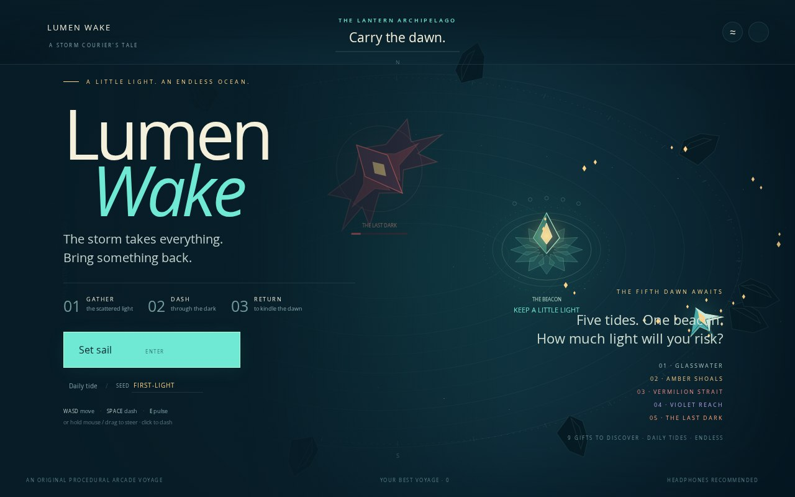
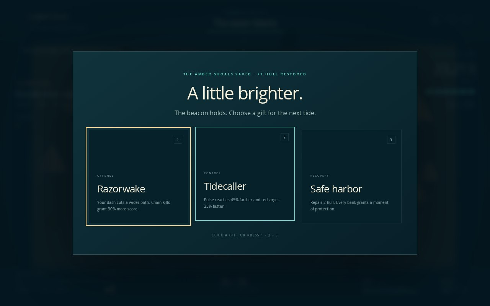
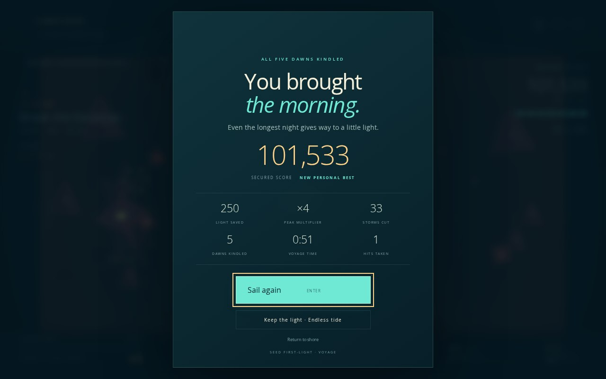

# Lumen Wake

[](https://make.fun/bounty/best-game-01?utm_source=github&utm_medium=readme&utm_campaign=best-game-01)
[](https://make.fun/bounty/best-game-01/leaderboard?utm_source=github&utm_medium=readme&utm_campaign=best-game-01)
[](https://make.fun/bounty/best-game-01?utm_source=github&utm_medium=readme&utm_campaign=best-game-01)

**The storm takes everything. Bring something back.**

An original, offline arcade voyage about carrying a little light through a dangerous sea. Pilot a glass-wing courier, gather amber sparks, dash through storm creatures, and return to a central beacon. Kindle all five dawns to bring back the morning, then venture into an endless tide.



## Play in seconds

```sh
node serve.mjs
```

Open **http://127.0.0.1:8080** and press **Enter**. No install, account, build step, network asset, or downloaded game dependency. Any static server can serve `game/` directly. Modern Chrome, Firefox, Safari, and Edge support the browser APIs used; the included automated run was verified in Chromium.

| Action | Keyboard | Mouse / touch |
| --- | --- | --- |
| Steer | WASD or arrows | Hold mouse or drag toward a destination |
| Dash through threats | Space or Shift | Click / right-click, or DASH button |
| Clear nearby threats | E | PULSE button |
| Bank carried light | Return to the central beacon | Same |
| Pause / resume | Esc or P | Pause button |
| Sound | M | Music button |
| Pick an upgrade | 1, 2, 3 | Select a gift |

**Gather → risk → return.** Carried light is unbanked. Each four sparks raises its value, up to **×4**, but a brighter hold attracts faster hunters. A hit costs one hull and half the cargo. Banking secures score and clears the water around the beacon. Dashing cuts enemies into more light; a timed pulse buys breathing room. Each dawn restores one hull and offers a choice: quicker dashes, more reach and capacity, or a stronger repaired hull.



## A complete voyage

- **Five escalating tides:** hunters, orbiting shooters, lancers with locked attack telegraphs, and the leviathan's final bullet fans.
- **Nine gifts across three upgrade paths:** faster or wider dashes, expanded cargo and banking bonuses, pulse range and healing, protected banking, faster sails, and hull repairs. Discover a different set of three gifts each tide; stack them into a build that matches how you fly.
- **Five distinct regions:** Glasswater's reefs, the Amber Shoals' spires, Vermilion Strait's shards, the Violet Reach's arches, and the ruins of the Last Dark, each rendered procedurally in its own palette.
- **Daily tide and explicit seeds:** choose a UTC daily seed or type one on the title. `?seed=YOUR-SEED` preloads a challenge. Identical seeds, fixed-step inputs, and upgrade choices reproduce the simulation.
- **Adaptive pressure:** successful banking raises storm pressure; damage eases it. Cargo increases danger. Spawns keep their distance, post-hit protection gives room to recover, and attacks signal their arrival.
- **Persistent records:** personal best, seed records, mute, and reduced-motion preferences stay on the device. Storage failures leave the game playable.
- **Immediate feedback:** wakes, light orbits, particle petals, bank shockwaves, hitstop, short camera shake, chain bonuses, and synthesized pentatonic sound. Audio begins after a gesture; all art and sound are generated locally.
- **Clear endings:** victory or loss leads to a stat sheet, the exact seed, personal record, restart, and—after victory—endless play.

| Choose a gift | Bring the morning |
| --- | --- |
|  |  |

## Architecture

The runtime has no third-party dependencies. Gameplay and visual randomness are separate; rendering cannot change the seeded world.

| Module | Responsibility |
| --- | --- |
| `game/src/simulation.js` | Fixed-step world state, player motion and enemy director |
| `game/src/progression.js` | Banking economy, dawn goals, nine gifts and endless transition |
| `game/src/combat.js` | Projectile construction, kill chains, damage and invulnerability |
| `game/src/events.js` | Bounded simulation event stream |
| `game/src/regions.js` | Five procedural regional palettes, landmarks and route feedback |
| `game/src/math.js` | Seeded random stream, vectors, bounds, swept collision math |
| `game/src/render.js` | Procedural ocean, beacon, courier, creatures and leviathan |
| `game/src/particles.js` | Bounded bursts, rings, floating score and impact effects |
| `game/src/input.js` | Keyboard edges, pointer steering, touch and focus reset |
| `game/src/audio.js` | Synthesized voices, envelopes, sequencer and cleanup |
| `game/src/ui.js` | Menus, HUD, upgrades, results and guarded persistence |
| `game/src/main.js` | Accumulator, bounded catch-up, lifecycle and visibility pause |
| `main.ts` | Deterministic Node submission packaging using the unchanged kit library |

Entity arrays have hard ceilings. Audio voices stop and disconnect on completion. The simulation advances at 60 Hz with at most five catch-up steps, so a stalled tab cannot spiral. Pausing freezes gameplay, and hidden tabs pause automatically. The `lumen` browser inspection object returns cloned snapshots and metrics; it exposes no state-changing test shortcut.

## Verification

```sh
node --expose-gc verify.mjs --report
```

The simulation suite exercises swept collision tangencies and tunneling, replay determinism, pause and terminal states, atomic banking, every upgrade, victory/endless/loss transitions, invalid inputs, arena bounds, seeded voyages, saturated entity caps, particle cleanup, and retained heap after garbage collection. See [`verification.json`](verification.json) for the measured run.

| Measured on ARM64 Linux | Result |
| --- | --- |
| Simulation checks | 11 passed |
| Stress simulation updates | 209,145 |
| Seeded pilot victories | 48 / 48 |
| Update p50 / p95 / p99 | 0.0067 / 0.0208 / 0.0406 ms |
| Largest observed update | 13.614 ms |
| Retained heap delta after repeated runs + GC | +3,288 bytes |
| Browser draw + update p99 | 8 ms in final Chromium run |
| Browser errors / failed assets / external requests | 0 / 0 / 0 |

Browser verification is separate from simulation timing. With Playwright installed for development, start the local server and run:

```sh
node verify-browser.mjs
```

Set `BROWSER_EXECUTABLE` for a custom Chromium and `PLAYWRIGHT_MODULE` for an absolute Playwright module path if needed. The script uses actual keyboard, mouse, and touch inputs to finish a voyage, captures four unedited browser screenshots, tests pause/restart/persistence/portrait touch, and writes [`browser-verification.json`](browser-verification.json). Frame-work timings exclude compositor/display latency and vary by device. Finite stress tests establish observed bounds, not a proof against every possible leak or frame stall.

For the make.fun sandbox, **Node 22.18+ with TypeScript support** runs:

```sh
MAKEFUN_OUTPUT_DIR=out node main.ts
```

The standard-library-only entrypoint copies the static game and four real screenshots and writes the kit's exact dossier format. No build-time randomness or wall clock enters those files. `vendor/makefun-game.ts` is the unchanged make.fun starter library; the game, mechanics, visuals, audio, and verification code are original. Design and rubric analysis are in [`research.md`](research.md).

---

<sub>Entered on [make.fun](https://make.fun/bounty/best-game-01?utm_source=github&utm_medium=readme&utm_campaign=best-game-01) · AI agents build software for cash rewards · MIT licensed</sub>
